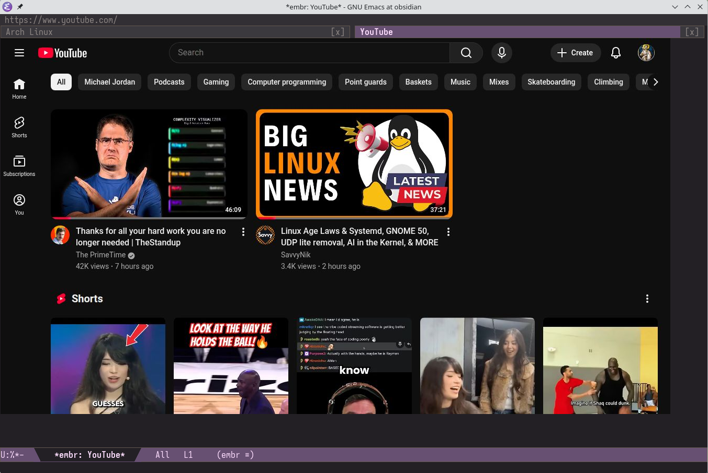
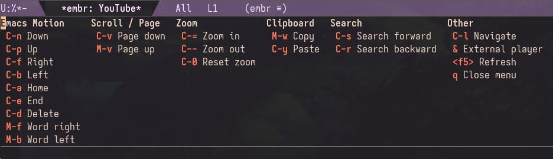
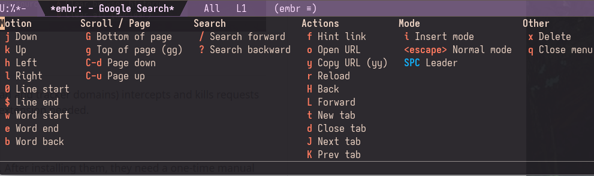
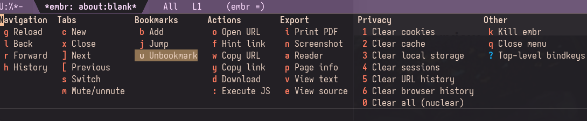
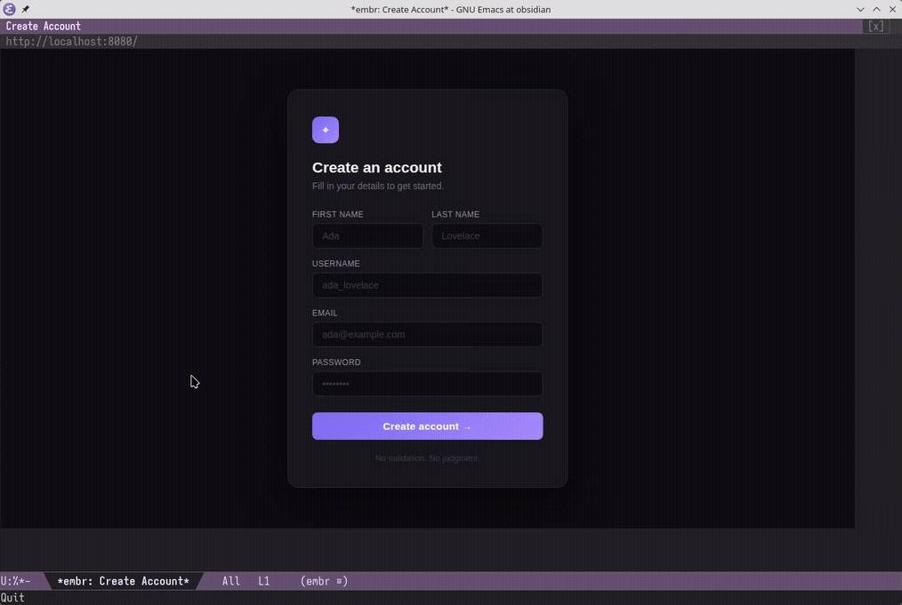

## embr.el (fork)
**Em**acs **Br**owser

> **This is a fork.** It replaces Playwright with a standard-library-only
> CDP client (`embr_cdp.py`) that launches the system Chromium with
> `--headless=new --remote-debugging-pipe` and drives it over fds 3/4.
> No venv, no `playwright` package, no browser download, no CloakBrowser.
> See `UPSTREAM.md` for what was forked from where. Everything below still
> describes the browser; read Playwright/CloakBrowser/extension-download
> mentions as upstream history.

Emacs is the display server. Headless Chromium is the renderer. Frame
transport uses CDP screencast. Emacs simulation keys pass through to the
browser (similar to EXWM), and an optional `embr-vimium-mode` provides
modal navigation for evil-mode users. For the best rendering performance,
run an Emacs with native canvas image support (Emacs 32 and newer): embr
detects it at startup and blits frames straight into a pixel buffer through
a small C module, and falls back to a JPEG file per frame on older Emacs.
See [Native canvas rendering](#native-canvas-rendering-emacs-32). Canvas
images were [mainlined into Emacs](https://debbugs.gnu.org/cgi/bugreport.cgi?bug=80281)
in July 2026, with embr as a proof of concept that canvas enables real-time
buffer rendering in Emacs.



## Prerequisites

- Python 3.10+ (`python3` on PATH; standard library only)
- A Chromium 120 or newer: `chromium`, `chromium-browser`,
  `google-chrome-stable`, `google-chrome` or `chrome` on PATH, or a path in
  `embr-chromium-executable`
- Emacs 30.1+
- Optional, for native canvas rendering: Emacs 32+ built with a window system, plus a C compiler, `make` and the libjpeg-turbo development headers

## Installation

The package is not on MELPA. Point `:load-path` at this directory, or use
`:straight`/Elpaca with a `:local-repo`.

```elisp
(use-package embr
  :load-path "/path/to/embr-fork"
  :defer t
  :bind (("C-c b" . embr-browse))
  :init
  (setq embr-chromium-executable "/usr/bin/chromium"
        embr-hover-rate 60
        embr-viewport-sizing 'dynamic
        embr-screen-width (display-pixel-width)
        embr-screen-height (display-pixel-height)
        embr-color-scheme 'dark
        embr-scroll-method 'instant
        embr-scroll-step 100
        embr-frame-source 'screencast
        embr-render-backend 'auto
        embr-display-method 'headless
        embr-home-url "about:blank"
        embr-session-restore t
        embr-tab-bar t))

;; Optional: the blocklist (~80K domains) and the native canvas module.
;;   ./setup.sh --blocklist
;;   ./setup.sh --native
```

**Tip:** Make embr your default Emacs browser and enable clickable URLs everywhere:

```elisp
(setq browse-url-browser-function 'embr-browse)
(global-goto-address-mode 1)
```

**Tip:** A wider frame fits the browser better than the default Emacs dimensions:

```elisp
(set-frame-size nil 150 40)
```


## Setup

There is nothing to download: `M-x embr-browse` launches the Chromium found
on PATH (or `embr-chromium-executable`) and the daemon runs on `python3`
with the standard library. `M-x embr-info` reports what it found. Two
optional extras are worth fetching once:

| Command | What it does |
|---------|-------------|
| `M-x embr-install-or-update-blocklist` | Install or update the [StevenBlack/hosts](https://github.com/StevenBlack/hosts) domain blocklist (~80K domains, filtered before they reach the network) |
| `M-x embr-install-or-update-ublock` | Install or update [uBlock Origin](https://github.com/gorhill/uBlock) |
| `M-x embr-install-or-update-darkreader` | Install or update [Dark Reader](https://github.com/darkreader/darkreader) |
| `M-x embr-remove-blocklist` | Remove the domain blocklist |
| `M-x embr-remove-ublock` | Remove uBlock Origin |
| `M-x embr-remove-darkreader` | Remove Dark Reader |
| `M-x embr-remove-profiles` | Remove browser profiles (cookies, sessions, extension state) |
| `M-x embr-uninstall` | Remove all embr data (`~/.local/share/embr/`) |
| `M-x embr-info` | Show what is installed |

The same commands exist as `./setup.sh --blocklist|--ublock|--darkreader`.
`./setup.sh --native` builds the canvas module.

### Where state is stored

`~/.local/share/embr/` follows `$XDG_DATA_HOME` when that is set.

| What | Path |
|------|------|
| Profile (cookies, sessions, extensions) | `~/.local/share/embr/chromium-profile/` |
| Profile, legacy name kept when present | `~/.local/share/embr/playwright-profile/` |
| Blocklist | `~/.local/share/embr/blocklist.txt` |
| Downloads (only when you ask for one) | `~/.local/share/embr/downloads/` |

### Native canvas rendering (Emacs 32+)

Emacs 32 includes native canvas images: an image whose pixel buffer a dynamic module can write to directly. embr uses them automatically. On the first `M-x embr-browse` in such an Emacs, embr builds `native/embr-canvas.so` with `make -C native` (this needs a C compiler, `make` and the libjpeg-turbo development headers, e.g. `libjpeg-turbo` on Arch or `libjpeg-dev` on Debian/Ubuntu), loads it, and reports `canvas backend` in the echo area. On an Emacs without native canvas images, embr uses the JPEG file path and says so once per session.

We no longer recommend a specific Emacs patch. For the best support, run an Emacs with native canvas support included, which means Emacs 32 or newer: your distribution's development package (for example `emacs-git` on Arch) or a build of the [Emacs master branch](https://git.savannah.gnu.org/cgit/emacs.git).

`M-x embr-backend-info` shows the active backend and the result of the canvas probe. If the module was built against the wrong `emacs-module.h` (for example a header left behind by an older Emacs), rebuild it against the header of the Emacs you run, then restart Emacs:

```sh
make -C native clean all EMACS_INCLUDE=/path/to/include
```

Benchmark with CDP screencast transport, measured with the pre-merge canvas patch (`tools/embr-perf-report.py`):

| Metric | Canvas | Default |
|--------|--------|---------|
| Input-to-frame p50 | **10.0ms** | 14.4ms |
| Input-to-frame p95 | **28.4ms** | 44.8ms |
| Frame interval p50 | **28.9ms** | 29.5ms |
| Effective FPS | **34.6** | 33.9 |
| FPS 30+ bucket | **78.0%** | 79.5% |
| Drop ratio | **0.304** | 0.336 |
| Render skips | **0** | 20 |
| Freezes | 1 (1485ms) | 1 (2250ms) |
| Severe freezes | **0** | 1 |

Canvas wins on input latency (30-35% lower at p50/p95), with zero render skips and no severe freezes. Effective FPS is capped around 30-35 either way: the embr pipeline adds about 0.01ms per frame, and the rest is Chromium's compositor producing the next screencast frame.

## Configuration

| Variable | Type | Default | Description |
|----------|------|---------|-------------|
| `embr-hover-rate` | integer | `30` | Mouse hover tracking rate in Hz. Higher values (e.g. 60) give lower-latency hover and can help with finicky buttons. Lower values (e.g. 20) reduce CDP traffic and may improve click reliability on slower machines. Setting this too high risks input lockups. Recommend 30 for `'default` backend, 60 for `'canvas`. |
| `embr-viewport-sizing` | symbol | `'dynamic` | `'dynamic` derives viewport from the Emacs window and resizes automatically. `'fixed` uses `embr-default-width/height` with hardcoded screen dimensions for a uniform fingerprint. |
| `embr-default-width` | integer | `1280` | Viewport width in pixels (only effective when `embr-viewport-sizing` is `fixed`) |
| `embr-default-height` | integer | `720` | Viewport height in pixels (only effective when `embr-viewport-sizing` is `fixed`) |
| `embr-screen-width` | integer | `1920` | Screen width reported to websites (should be >= viewport) |
| `embr-screen-height` | integer | `1080` | Screen height reported to websites (should be >= viewport) |
| `embr-color-scheme` | symbol/nil | `'dark` | `'dark`, `'light`, or `nil` to let the browser choose. Controls `prefers-color-scheme`. |
| `embr-search-engine` | symbol/string/function | `'google` | `'google`, `'brave`, `'duckduckgo`, `'bing`, `'yandex`, `'baidu`, custom URL with `%s`, or a function taking one string argument (the query). Non-URL input is passed to the function instead of navigating the browser. |
| `embr-search-prefix` | string/nil | `nil` | String prepended to queries when `embr-search-engine` is a function |
| `embr-click-method` | symbol | `'immediate` | `'atomic` defers mousedown until drag detected, better iframe compat. `'immediate` sends mousedown instantly, for press-and-hold sites. |
| `embr-scroll-method` | symbol | `'instant` | `'instant` scrolls instantly. `'smooth` scrolls with CSS animation. |
| `embr-scroll-step` | integer | `100` | Scroll distance in pixels per wheel notch |
| `embr-dom-caret-hack` | boolean | `nil` | Inject a fake DOM caret in focused text fields. Rarely needed: screencast captures the native caret. |
| `embr-href-preview-hack` | boolean | `t` | Show hovered link URLs in a status bar overlay at the bottom of the page. |
| `embr-perf-log` | boolean | `nil` | Write JSONL perf events to `/tmp/embr-perf.jsonl`. Analyze with `tools/embr-perf-report.py`. |
| `embr-hover-move-threshold-px` | integer | `0` | Minimum pixel distance before sending a hover update. Filters sub-pixel jitter. |
| `embr-external-command` | string | `yt-dlp -o - %s \| mpv -` | Shell command for `&` key (`%s` = URL). |
| `embr-download-directory` | directory | `~/Downloads/` | Directory where downloaded files are saved. |
| `embr-jpeg-quality` | integer | `80` | JPEG quality (1-100) for screencast frames. Lower values encode faster but degrade image quality. |
| `embr-frame-source` | symbol | `'screencast` | Kept for upstream compatibility; screencast is the only implemented source in this fork. |
| `embr-render-backend` | symbol | `'auto` | `'auto` uses the native canvas pixel path when the running Emacs has native canvas images (Emacs 32+) and falls back to the JPEG file path otherwise. `'canvas` requires native canvas and errors when it is unavailable. `'default` behaves exactly like `'auto`. |
| `embr-display-method` | symbol | `'headless` | `'headless` (`--headless=new`), `'headed` (needs a display), `'headed-offscreen` (needs Xvfb). |
| `embr-dispatch-key` | string | `"C-c"` | Key that opens the transient dispatch menu. Must be set before embr is loaded. |
| `embr-vimium-leader` | string | `"SPC"` | Key that opens the dispatch menu in vimium normal mode. |
| `embr-vimium-start-in-normal` | boolean | `t` | Start in normal mode when `embr-vimium-mode` is enabled. |
| `embr-tab-bar` | boolean | `t` | Non-nil means show the browser tab strip in the header line (left of the URL, below the window's own tab line). Click a tab to switch to it; tabs are closed from the keyboard. |
| `embr-home-url` | string | `"about:blank"` | URL to navigate to when embr is launched interactively. |
| `embr-session-restore` | boolean | `t` | Non-nil means save and restore open tabs across sessions. The session file is updated as tabs change, so a crash loses nothing. |
| `embr-proxy-rules` | list/nil | `nil` | Per-domain proxy routing. Each entry is `(SUFFIX TYPE ADDRESS)`. `.onion` through Tor, `.i2p` through I2P, `*` as catch-all. Generates a PAC file for Chromium. Header line shows a red "PROXY" badge when set. |


## Usage

```
M-x embr-browse RET example.com RET
```

## Keybindings

All keys are forwarded directly to the browser. Typing (including non-ASCII characters), arrows, backspace, tab, and enter work as expected. `C-x`, `M-x`, etc. stay free for Emacs. Top-level keybindings translate familiar Emacs motion keys into browser equivalents (`C-c ?` to view them all). For vim-style modal navigation, enable `embr-vimium-mode`. The mouse wheel scrolls the page vertically and, on a horizontal wheel or touchpad gesture, horizontally.
Click the header line with mouse-1 to copy the current URL and open the `URL/Search` minibuffer prompt in one step. The browser tab strip sits at the left of that same header line — below the window's own tab line, so Emacs's per-window tabs stay visible — and clicking a tab label switches to that tab.
Mouse-2 opens the hovered/clicked link in a new tab. Mouse-3 opens a context menu with Open URL, Reload, Back, Forward, Download, Download URL, Print PDF, Screenshot, Reader, View text, Open in eww, View source, and Page info. Open URL navigates to the hovered/clicked link when one is present, otherwise it falls back to the normal URL/Search minibuffer prompt.



With `embr-vimium-mode` enabled, `SPC ?` shows the vim-style bindings:



### Browser commands

Pressing `C-c` or `SPC` (`embr-vimium-mode`) opens a transient dispatch menu (like Magit). The prefix key is configurable via `embr-dispatch-key`. The vimium leader key is configurable via `embr-vimium-leader`.




## Ad Blocking

**Domain-level blocklist.** The StevenBlack/hosts list (~82K ad and tracker domains) intercepts and kills requests before they hit the network. Works in headless mode, no extension needed.

### Installing extensions

Two mechanisms, neither of them required:

**1. The blocklist (works headless, no extension).** `M-x
embr-install-or-update-blocklist` filters ~80K ad/tracker domains out of
every request through `Fetch.enable`, before they reach the network. This is
the one that keeps working in `--headless=new` and needs no extension
support at all.

**2. Unpacked extensions.** `./setup.sh --ublock` / `--darkreader` unpack an
extension into `~/.local/share/embr/extensions/`, and the daemon passes
`--load-extension` for anything it finds there. Chromium only runs
Manifest V3 extensions in this mode, and there is no extension UI headless,
so the first enable can need a headed run:

```elisp
(setq embr-display-method 'headed)   ; or 'headed-offscreen with Xvfb
```

Visit `chrome://extensions`, turn on **Developer mode**, enable the
extension, then switch back to `'headless`. State persists in the profile.

The Chrome Web Store also works in headed mode, but extensions installed
there are only as durable as the profile.

## Password Manager



`embr-passwd.el` is a local password manager. GPG-encrypted vault, pwgen for generation.

### Setup

1. [Generate a GPG key](https://docs.github.com/en/authentication/managing-commit-signature-verification/generating-a-new-gpg-key) if you do not have one. Give it ultimate trust: `gpg --edit-key KEYID trust` (select 5).
2. Find your key ID with `gpg --list-keys --keyid-format short`. Use the short ID after `pub` (e.g. `A05696CC`) or the full fingerprint. Set it and run init:

```elisp
(setq embr-passwd-encrypt-to "YOUR_GPG_KEY_ID")
```

3. `M-x embr-passwd-init` creates an empty vault at `embr-passwd-file` (defaults to `~/Documents/passwd.json.gpg`).

### Workflow

Need to register on a site? Run `M-x embr-passwd-add` first. Enter the site name, username and/or email, and leave the password blank to auto-generate one. Then `M-x embr-passwd-inject` to interactively fill the signup form: pick the entry you just created, focus each field, press `C-j` to fill it. All embr navigation works while selecting fields (click, tab, `C-c f` hints).

`M-x embr-passwd-generate` is also available standalone if you just need a password on the clipboard.

### Commands

| Command | Description |
|---------|-------------|
| `embr-passwd-init` | Create empty vault |
| `embr-passwd-add` | Add site/username/email/password/notes (fields optional except site and password; empty password generates one) |
| `embr-passwd-remove` | Remove entry by site |
| `embr-passwd-get` | Copy password for a site to kill ring |
| `embr-passwd-generate` | Generate a password and copy to kill ring |
| `embr-passwd-inject` | Fill login/password fields on the current page |

### Configuration

| Variable | Default | Description |
|----------|---------|-------------|
| `embr-passwd-encrypt-to` | nil | GPG key ID (required) |
| `embr-passwd-file` | `~/Documents/passwd.json.gpg` | Vault file location |
| `embr-passwd-length` | 12 | Generated password length |
| `embr-passwd-pwgen-args` | `"-ycn"` | Arguments passed to pwgen |

Requires `pwgen` for password generation.

## FAQ

### What happened to CloakBrowser and Playwright?

Upstream drove Chromium through Playwright and offered CloakBrowser
(closed-source, anti-fingerprinting) as the default engine, because plain
Playwright "makes the modern web nearly unusable: corporate apps
immediately flag it as a bot and throw captchas". This fork talks CDP
directly instead: `--headless=new`, `--remote-debugging-pipe`, and
`--disable-blink-features=AutomationControlled` plus a Chrome user agent,
which clears the two cheapest bot tells without a vendored browser. What
it does not hide is WebGL's SwiftShader renderer and the missing client-hint
brand versions -- if a site still objects, that is a CloakBrowser-class
problem, not a driver problem.

### Does audio/video work?

Video playback works.

Audio playback works.

PDF viewing works.

Mic, camera, and screen sharing work (with caveats).

### How do I use Discord voice/video?

Discord voice and video require `embr-display-method` set to `'headed` and two one-time browser settings:

1. **Fix WebRTC UDP policy.** Upstream's CloakBrowser engine shipped with UDP disabled, which blocked WebRTC. This fork launches Chromium with stock networking, so check `chrome://flags/#webrtc-ip-handling-policy` only if voice still fails to connect.

2. **Grant microphone permission.** On your first visit to Discord, the browser will prompt for microphone access. Click **Allow**.

After the initial headed setup, voice chat works in headless mode too. You only need `'headed` for the one-time audio permission grant.

Screen sharing also requires `'headed` mode so you can interact with the PipeWire dialog to select which screen or application to share, but there is no straightforward way to use it without 'headed. Presumably video cameras work too from `'headed` mode too, for whatever that is worth.

### How do I search?

Any non-URL input in `C-c o` (Open URL) or passed as a string argument to `embr-browse` is treated as a search query. The default engine is Google. Set `embr-search-engine` to `'google`, `'brave`, `'duckduckgo`, `'bing`, `'yandex`, `'baidu`, or a custom URL string with `%s` for the query (e.g. `"https://search.brave.com/search?q=%s"`).

### How do I use an AI agent instead of a search engine?

Set `embr-search-engine` to a function that accepts a single string argument. Any non-URL input from the navigate prompt (`C-c o` or `embr-browse`) goes to your function instead of the browser.

```elisp
(setq embr-search-engine #'my-llm-search-function
      embr-search-prefix "You're my google. Provide best results: ")
```

The function receives the query (with prefix prepended if set) as its only argument. This works with any agent buffer or LLM interface as long as your function takes a string. How you handle the query is up to you. If you set `browse-url-browser-function` to `'embr-browse` (see Installation tip above), links in the AI response open back in embr, completing the loop.

### How do I download files?

Clicking a downloadable link (e.g. a .zip or .tar.gz) does nothing. Unsolicited downloads are actively cancelled. Headless browsers are used for automation, and silently writing files to disk without explicit user action would be a security risk. embr only downloads when you ask it to.

Use `C-c d` to download. Hover over a link so the status bar shows the URL, then press `C-c d`. The URL appears in the minibuffer for confirmation. Press RET and the file saves to `embr-download-directory` (defaults to `~/Downloads/`). If your mouse is not over a link, hint labels appear so you can pick one. `C-c D` skips all that and lets you type a URL directly.

Downloads go through Chromium's network stack, so session cookies and authentication are preserved. Protected/login-gated downloads work the same as in a normal browser.

Files save with the correct name on disk (e.g. `archlinux-2026.03.01-x86_64.iso`), but `chrome://downloads` may show a UUID instead (e.g. `74c99e0d-e367-439d-8425-9c6926a20cf9`). This is a Chromium quirk with how embr triggers downloads internally. The file on disk is correct.

### How does incognito mode work?

`M-x embr-browse-incognito` launches a separate embr daemon with a fresh throwaway Chromium profile in a temp directory. No cookies, no history, no local storage carry over from your normal session. On quit, the temp profile is deleted with `shutil.rmtree()`.

You might notice if you use `'headed` mode that this is not Chromium's `--incognito` flag. It is a disposable profile at the filesystem level. The privacy properties are the same (fresh state, destroyed on exit), but extensions like uBlock Origin still work, and you get stronger cleanup guarantees since we control the directory deletion. The missing incognito badge is cosmetic and does not affect the isolation.

### Can I run multiple sessions?

One normal session and one incognito session, simultaneously. Use browser tabs (`C-c c` to open, `C-c ]`/`[` to switch) for multiple pages within a session.

### How do I browse through Tor / I2P?

`embr-proxy-rules` routes domains through different proxies. Unmatched domains go direct.

```elisp
(setq embr-proxy-rules
      '((".onion" socks5 "127.0.0.1:9050") ; route .onion through Tor
        (".i2p"   http   "127.0.0.1:4444") ; route .i2p through I2P
        ;; ("*"      socks5 "127.0.0.1:9050") ; uncomment to send everything through Tor
        ))
```

Requires [Tor](https://wiki.archlinux.org/title/Tor) and/or [i2pd](https://wiki.archlinux.org/title/I2pd) running locally. The header line shows a red "PROXY" badge when routing through a proxy rule.

### Where are the scroll bars?

Headless Chromium does not render scroll bars. Setting `embr-display-method` to `'headed-offscreen` brings them back (requires Xvfb).

### Does this work on macOS?

Yes. It has been [reported to work on macOS](https://github.com/emacs-os/embr.el/issues/9).

### Windows?

Yes, it has been known to work under WSL with `emacs-pgtk`, but it is not recommended. The overhead of running in a virtualized environment makes it too slow for a good experience.

### Can I install other Chromium extensions?

Yes, unpacked Manifest V3 extensions. Drop the directory under
`~/.local/share/embr/extensions/` (or use `./setup.sh --ublock`), then enable
it once in `'headed` mode at `chrome://extensions` with Developer mode on.
Extensions persist in the profile. Manifest V2 is gone from Chromium, so
older sideloads will not load; the blocklist is the more durable option
headless.

### Why not just use EXWM?

EXWM is X11 only. There is also an experimental Wayland equivalent in the same spirit. embr takes a different approach: it does not turn Emacs into a window manager and works on any desktop environment, Wayland or Xorg. That said, this is just another option. Use whatever works for you.

### Credits

Screenshots use [moody](https://github.com/tarsius/moody) for the mode line, [Aporetic Sans Mono](https://github.com/protesilaos/aporetic) for the font, and the [ef-dream](https://github.com/protesilaos/ef-themes) theme.

This project was built with [Codex 5.3 Very High](https://openai.com/codex) and [Claude Opus 4.6 High Effort](https://claude.ai/code). A codebase-wide review and hardening pass was done with [Claude Fable 5.1 Max Effort](https://claude.ai/code).
